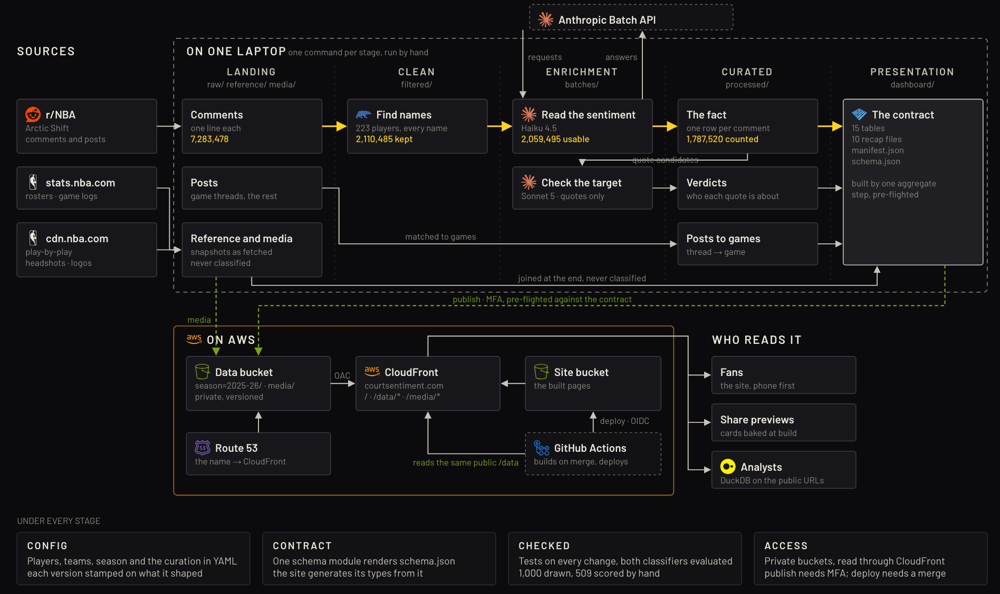

#  Court Sentiment


**Who is r/NBA's most hated player? Every comment, classified.**

Every r/NBA comment of a season that names a tracked player is read by a large language model, tied to one player, and counted. The counts become a published data contract, and the site is built from the contract. The project started as NBA Hate Tracker.

📊 [**courtsentiment.com**](https://courtsentiment.com)



- **Contract first.** Every table is written against a versioned schema, stamped with the config that produced it, and the publish step refuses a file that doesn't match.
- **2.1M comments classified for about $295** through the Batch API, with a second model reading anything the site quotes.
- **A blind, hand-labeled sample**, published with its margins.
- **A static site that fails its own build** when the data moves out from under its types or its copy.

---

## Seasons

| Season | Comments attributed | Players tracked | Most hated | Where |
|--------|--------------------:|----------------:|------------|-------|
| 2025-26 | 1,787,520 | 223 | James Harden, 55.3% negative | [courtsentiment.com](https://courtsentiment.com) |
| 2024-25 | 1,567,722 | 111 | Draymond Green, 51.0% negative | Built under the V1 contract |

A season is a directory: `config/<season>/` holds the player aliases, the calendar and the curated copy; `data/<season>/` holds everything derived from them. The site serves the seasons listed in `web/src/site.ts`.

## How it works

The 2025-26 season, step by step. The site's [How it works](https://courtsentiment.com/how-it-works/) page follows one real comment through the same stages.

| Stage | 2025-26 | What happens |
|-------|--------:|--------------|
| Download | 7,283,478 | Every r/NBA comment from October 1 to June 30, preseason through the draft, from the [Arctic Shift](https://arctic-shift.photon-reddit.com/) archive. Posts come down the same way |
| Filter | 2,110,485 | Comments that name a tracked player, matched against 721 aliases for 223 players. Short names only match as whole words, so "ant" does not match "want" |
| Classify | 2,110,479 | Sentiment (negative / neutral / positive), a confidence, and the player the model thinks it's about |
| Usable | 2,059,495 | Malformed or errored responses dropped |
| Attribute | 1,787,520 | One rule decides who a comment counts for: one name, that player; several names, whichever tracked player the classifier names; otherwise nobody |

Aggregation then cuts the attributed comments by player, fanbase (the commenter's flair), week, game thread and room, joins the game layer (schedule, box scores, play-by-play from the NBA's live feed) and writes the contract.

### Classification

One model reads every comment. A second, larger one checks only what the site quotes.

**Claude Haiku 4.5** reads every comment through the [Anthropic Batch API](https://docs.anthropic.com/en/docs/build-with-claude/batch-processing). The prompt is short, the same for every comment, and published word for word in the manifest. It knows the slang: "washed," "cooked," and "fraud" read negative; "nasty," "filthy," and "GOAT" read positive; a trailing "/s" marks sarcasm.

**Claude Sonnet 5** reads only the comments that could be quoted on a player page (positive or negative, confidence ≥ 0.9) and names who the opinion is aimed at. A comment about a trade is not a comment about the player traded. The check decides what is quoted, not what is counted.

**2025-26 at scale:**

- 22 batches of up to 100K requests, about 25 hours wall clock
- 295.6M input tokens + 56.8M output tokens
- $289.79 for sentiment, $5.05 for the verifier's 15,806 reads
- Every prompt, model id, sampling parameter and config version is stamped into the published manifest

### Accuracy

A blind random draw of **1,000** counted comments, each read and labeled under a written rubric without the classifier's answer in view. 530 were labeled across two groups, 21 rejected under the rubric, and **509** scored; the estimate is weighted across the groups. Margins at 95%.

| Agreement | Rate |
|-----------|-----:|
| On the sentiment | 68.6% ± 5.0 |
| On the player | 95.4% ± 2.9 |
| On both | 66.0% ± 5.0 |

A label is a careful read, not the truth. Where the two disagree, the site shows both and does not pick. Negative and neutral sit within their margins. Positive does not: the classifier calls fewer comments positive than I do, because quiet approval reads as neutral.

## The contract

Aggregation writes one Parquet file per table, a `manifest.json` and a `schema.json` to `data/<season>/dashboard/`. The publish step uploads exactly that set to S3 after checking it against the schema. The site generates its TypeScript types from the published `schema.json` and asserts every table against it at build.

- **`manifest.json`** is the typed contract: the season's identity, both classifiers' prompts, the rules every page obeys (floors, thresholds, the receipt gate), the accuracy figures, and the registry of tables and recap documents.
- **15 tables**, from `player_overall` and `player_fan_team` to the game layer (`games`, `player_games`, `game_sentiment`, `posts`) and the rooms (`player_room`, `room_temporal`).
- **10 recap documents**, one per curated game: every play on the wall clock, every comment in the thread aligned to it.

Public, read-only, one prefix per season:

```
https://courtsentiment.com/data/season=2025-26/manifest.json
https://courtsentiment.com/data/season=2025-26/schema.json
https://courtsentiment.com/data/season=2025-26/player_overall.parquet
```

```bash
duckdb -c "SELECT attributed_player, neg_rate, comment_count
           FROM 'https://courtsentiment.com/data/season=2025-26/player_overall.parquet'
           WHERE comment_count >= 5000 ORDER BY neg_rate DESC LIMIT 10"
```

[docs/data-model.md](docs/data-model.md) is the star schema behind the tables. [docs/publishing.md](docs/publishing.md) is the AWS shape and the runbook.

## The site

Astro with React islands, static, built from the contract and deployed to S3 behind CloudFront by GitHub Actions: rebuilt on every change under `web/`, and dispatched after every data drop. No rule or figure on the site is typed in; every one reads from the manifest, and a curated sentence fails the build when the data moves out from under it.

| Page | What it shows |
|------|---------------|
| Leaderboard | Every player over the comment floor, ranked by negative share, with the fanbase lenses |
| Player | The verdict, the receipts (quoted comments that passed the verifier), the season on net, the games table, who talks about him |
| Fanbases | Which flair hates whom, and the grudges between them |
| Season | The nights, the rooms, the arcs, the loudest threads |
| The Race | The leaderboard replayed week by week |
| Recaps | A game thread as a simcast: the play-by-play and the thread on one clock |
| How it works | One comment followed from download to its row, the prompts, the check by hand |

Every page has a share card rendered at build.

## Limitations

- **Classifier agreement is 68.6% ± 5.0** on sentiment against a hand-labeled sample, 95.4% ± 2.9 on the player. Quiet approval read as neutral is the measured miss; untagged sarcasm is the other. The figures are on the site, with margins, and never rounded up.
- **Sentiment is not hate.** A factual criticism ("he shot 2-15 last night") and a personal attack both read negative. The metric is the negativity of the discourse, not hostility.
- **Every comment counts once.** A comment with 500 upvotes weighs the same as one with 1. This avoids popularity bias; it also means viral threads carry no extra weight.
- **One season at a time.** Rates move with trades, injuries and playoff runs, and no page compares across seasons.

## Stack

| Component | Technology |
|-----------|------------|
| Pipeline | Python 3.11, Polars, uv |
| Classifiers | Claude Haiku 4.5 (sentiment), Claude Sonnet 5 (target), Anthropic Batch API |
| Reddit | Arctic Shift archives |
| The league | stats.nba.com (games, rosters, box scores) and the cdn.nba.com live feed (play-by-play) |
| Contract | Parquet + JSON manifest and schema, versioned, stamped with config lineage |
| Site | Astro 7, React 19, TypeScript, hyparquet, satori (share cards), Playwright (the walk), vitest |
| Hosting | S3 + CloudFront + Route 53; GitHub Actions deploys on merge via OIDC |
| Ad hoc | DuckDB |

## Repository

```
├── pipeline/           # Core data processing modules
│   ├── arctic_shift.py     # Client for the Reddit archive
│   ├── processors.py       # Comment cleaning & name matching
│   ├── batch.py            # Anthropic Batch API: build, submit, collect
│   ├── targets.py          # The verifier pass on the quote candidates
│   ├── aggregation.py      # The aggregate views
│   ├── games.py, posts.py, recaps.py   # The game layer & the recap documents
│   ├── accuracy.py         # The hand-labeled sample, scored
│   ├── schemas.py          # The contract: every produced file's schema & the manifest
│   ├── contract.py         # Renders schemas.py as schema.json
│   ├── lineage.py          # Which config version stamps which file
│   └── publish.py          # The drop: pre-flight, upload, verify
├── scripts/            # CLI entry points, one per stage
│   ├── download_comments.py
│   ├── download_posts.py
│   ├── process_comments.py
│   ├── prepare_batches.py
│   ├── submit_batches.py
│   ├── collect_results.py
│   ├── prepare_targets.py
│   ├── fetch_games.py
│   ├── fetch_media.py
│   ├── aggregate_sentiment.py
│   ├── publish_dashboard.py
│   └── publish_media.py
├── utils/              # Stateless helpers
│   ├── paths.py
│   ├── formatting.py
│   └── *_config.py         # One loader per YAML file
├── config/             # Player aliases, team mappings, the season calendar
│   ├── season.yaml         # Which season is active
│   ├── teams.yaml
│   ├── publish.yaml
│   └── <season>/
│       ├── players.yaml    # 721 aliases → 223 players
│       ├── season.yaml     # Calendar & corpus facts
│       ├── recaps.yaml     # The curated games
│       └── method_examples.yaml
├── web/                # The site
│   ├── src/lib/            # Rules & sentences, each with its test
│   ├── src/components/     # Astro components & React islands
│   ├── src/pages/          # One file per route
│   ├── src/data/           # The contract boundary: load, assert, types generated from schema.json
│   └── walk/               # Playwright over dist/ at 1280 & 400
├── tests/              # pytest: unit, integration, eval
├── notebooks/          # EDA & validation, season-scoped
├── docs/               # data-model.md, publishing.md
├── .claude/            # Agent conventions: path-scoped rules, skills, pre-commit gate
└── data/               # Not committed: raw/ filtered/ batches/ processed/ reference/ dashboard/
```

## Running it

From a clone, no data needed:

```bash
uv sync && uv run pytest && uv run ruff check .     # Python
cd web && npm ci                                     # Site, Node 22
npm run dev                                          # Against the published data by default
npx playwright install chromium
npm run build && npm run walk                        # dist/ + Playwright at 1280 and 400
```

With a season's data under `data/<season>/`:

```bash
uv run python -m scripts.aggregate_sentiment --season 2025-26          # sentiment.parquet → the contract
uv run python -m scripts.publish_dashboard --season 2025-26 --dry-run  # Plan the drop; the drop needs the MFA role
```

Download, filter and classify are their own scripts under `scripts/`. Classify and the verifier want an `ANTHROPIC_API_KEY`. [docs/publishing.md](docs/publishing.md) has the rest.

## Cost

| Season | Classification | Verifier | Total |
|--------|---------------:|---------:|------:|
| 2025-26 | $289.79 | $5.05 | $294.84 |
| 2024-25 | $254.20 | $3.00 | $257.20 |

Data acquisition is free. Hosting is a domain, three buckets and one distribution:

| Running | Cost |
|---------|-----:|
| Domain, courtsentiment.com | $11.48 / year, registration plus the ICANN fee, WHOIS privacy included |
| AWS: S3, CloudFront, Route 53 | $0.06 in September 2026 on pay-as-you-go; CloudFront's Pro plan at $15 / month for access logs, until analytics moves to GA4 |

---

<p align="center">
  Built by <a href="https://github.com/oluobiri">@oluobiri</a> · Data sourced from <a href="https://arctic-shift.photon-reddit.com/">Arctic Shift</a> · MIT
</p>
